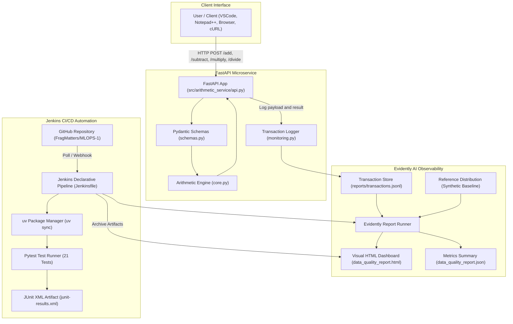

# MLOps Arithmetic Microservice: Design, Architecture, and Implementation Report

## 1. Problem Statement

Modern software engineering and Machine Learning Operations (MLOps) demand automated pipelines that seamlessly connect business logic, RESTful API exposure, continuous integration, and data quality/drift monitoring. The objective of this project is to implement four fundamental arithmetic operations and integrate them into an enterprise-grade CI/CD and monitoring ecosystem:

- **A. Addition**: Accept two numeric operands and return their arithmetic sum ($a + b$).
- **B. Subtraction**: Accept two numeric operands and return their difference ($a - b$).
- **C. Multiplication**: Accept two numeric operands and return their product ($a \times b$).
- **D. Division**: Accept two numeric operands and return their quotient ($a / b$), with explicit zero-division exception handling.

### Technical Integration Requirements:
- **FastAPI**: Asynchronous web framework exposing REST endpoints with strict Pydantic validation.
- **Pytest**: Automated unit and integration test suite with JUnit XML reporting.
- **Evidently AI**: Observability and monitoring engine to evaluate data quality and feature drift.
- **Jenkins**: Declarative CI/CD pipeline automation for builds, tests, and artifact archiving.
- **`uv`**: High-performance Python package and virtual environment manager.
- **Tooling/Environment**: Compatible with VSCode, Notepad++, Linux, and Git/GitHub.

---

## 2. Theoretical Background

### 2.1 Microservice Architecture and RESTful API Design
The application adopts a decoupled layered architecture separating pure domain logic from transport concerns:
- **Core Domain Layer (`core.py`)**: Stateless Python arithmetic functions adhering to single-responsibility principles.
- **Interface Layer (`api.py`, `schemas.py`)**: Powered by FastAPI and Pydantic v2. HTTP request payloads are validated at runtime, converting malformed types into deterministic HTTP 422 Unprocessable Entity responses and preventing zero-division runtime crashes with HTTP 400 Bad Request.

### 2.2 Continuous Integration & Test-Driven Verification (Pytest + Jenkins)
Continuous Integration (CI) guarantees regression avoidance through automated testing:
- **Unit Testing**: Verifies arithmetic computations against standard numbers, floating-point precision, negative numbers, and boundary conditions.
- **Integration Testing**: Uses FastAPI's `TestClient` (backed by `httpx`) to simulate live HTTP transactions without spinning up external network sockets.
- **Jenkins Declarative Pipeline**: Orchestrates multi-stage build execution inside isolated environments, publishing JUnit test metrics and archiving deployment artifacts.

### 2.3 Data Observability & Drift Monitoring (Evidently AI)
In production APIs and ML serving systems, input data distributions shift over time (data drift), and corrupted payloads degrade performance (data quality issues):
- Every calculation transaction is captured with its input operands and result.
- Evidently AI compares current production batches against baseline reference datasets using statistical tests (Wasserstein distance, Kolmogorov-Smirnov test, and missing-value share checks).
- An interactive visual HTML dashboard and machine-readable JSON metrics summary are produced automatically.

---

## 3. System Architecture



---

## 4. Project File Structure

```text
MLOPS-1/
├── Jenkinsfile                  # Declarative Jenkins CI/CD pipeline definition
├── pyproject.toml               # Project metadata, dependencies, and pytest configuration
├── uv.lock                      # Deterministic lockfile generated by uv
├── README.md                    # Project documentation and quickstart instructions
├── PROJECT_REPORT.md            # Comprehensive project theory, architecture, and commands
├── .gitignore                   # Excludes virtualenv, cache, and generated artifacts
├── src/
│   └── arithmetic_service/
│       ├── __init__.py          # Package initialization and pandas-evidently compatibility
│       ├── core.py              # Pure arithmetic functions: add, subtract, multiply, divide
│       ├── schemas.py           # Pydantic request/response validation models
│       ├── api.py               # FastAPI endpoints (/add, /subtract, /multiply, /divide, /health)
│       └── monitoring.py        # Evidently transaction logger and report generator
├── tests/
│   ├── __init__.py
│   ├── test_core.py             # Unit tests for core arithmetic operations
│   ├── test_api.py              # Integration tests for FastAPI endpoints (TestClient)
│   └── test_monitoring.py       # Unit tests for Evidently data logging and generation
└── reports/                     # Output directory for pipeline artifacts
    ├── .gitkeep                 # Preserves directory structure in Git
    ├── junit-results.xml        # Pytest test execution results (JUnit XML)
    ├── data_quality_report.html # Interactive visual Evidently report (Data Quality & Drift)
    ├── data_quality_report.json # Statistical metrics in machine-readable JSON format
    └── transactions.jsonl       # Real-time transaction log
```

---

## 5. Execution and Setup Commands

### 5.1 Environment Initialization with `uv`
```bash
# Verify uv installation
uv --version

# Synchronize dependencies and construct virtual environment
uv sync
```

### 5.2 Automated Testing with Pytest
```bash
# Execute unit and API integration tests with JUnit XML export
uv run pytest --junitxml=reports/junit-results.xml -v
```

### 5.3 Serving the FastAPI Application
```bash
# Start the local development server on port 8000
uv run uvicorn arithmetic_service.api:app --reload --host 0.0.0.0 --port 8000

# Test endpoints via cURL
curl -X POST http://127.0.0.1:8000/add -H "Content-Type: application/json" -d '{"a": 12, "b": 8}'
curl -X POST http://127.0.0.1:8000/subtract -H "Content-Type: application/json" -d '{"a": 20, "b": 5}'
curl -X POST http://127.0.0.1:8000/multiply -H "Content-Type: application/json" -d '{"a": 6, "b": 7}'
curl -X POST http://127.0.0.1:8000/divide -H "Content-Type: application/json" -d '{"a": 40, "b": 4}'
```

### 5.4 Data Quality & Drift Report Generation (Evidently AI)
```bash
# Trigger Evidently evaluation pipeline
uv run python -m arithmetic_service.monitoring
```

### 5.5 Git and GitHub Setup
```bash
# Initialize repository and commit source files
git init -b main
git add .
git commit -m "feat: implement arithmetic service with FastAPI, Pytest, Evidently, Jenkins and uv"

# Create public GitHub repository and push code using GitHub CLI
gh repo create MLOPS-1 --public --source=. --remote=origin --push
```

### 5.6 Jenkins Pipeline Configuration
1. Create a **New Item** in Jenkins of type **Pipeline**.
2. Under **Pipeline Definition**, select **Pipeline script from SCM**.
3. Set **SCM** to **Git** and Repository URL to `https://github.com/FragMatters/MLOPS-1.git`.
4. Set **Branch Specifier** to `*/main` and **Script Path** to `Jenkinsfile`.
5. Click **Build Now** to trigger the automated build, test, and reporting pipeline.
